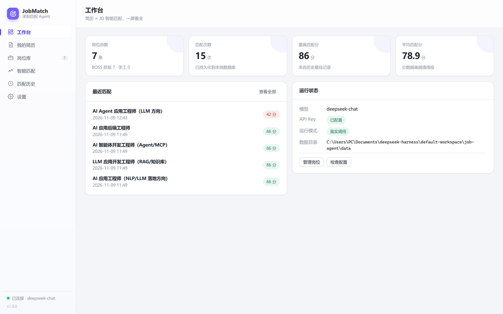

# JobMatch Agent · 求职匹配桌面应用

一个可以**双击安装**的 Windows 桌面应用：上传简历 → 抓取/录入目标岗位 JD → 用大模型做「简历 × JD」多维度匹配打分，并生成定制打招呼语 + 针对该 JD 的简历优化建议。

后端是 Python（FastAPI + LangGraph + Playwright），外壳是 Electron —— 桌面软件形态，但所有 AI 能力都在 Python 侧。



## 功能

| 模块 | 说明 |
|---|---|
| 工作台 | 岗位数 / 匹配次数 / 最高分 / 平均分，最近匹配与运行状态一屏看全 |
| 我的简历 | 拖入 PDF·DOCX·MD·TXT 或粘贴文本 → 大模型抽取结构化简历（姓名/技能/经历/教育/目标岗位），本地持久化 |
| 岗位库 | **一条龙抓取**：点「抓取岗位」→ 填关键词 / 城市 / 要多少条 JD / 匹配阈值 → 后台静默抓取（**不弹出招聘网站页面**，只有没登录时才弹一次登录窗，登录完自动收起）→ 抓够条数就停 → 自动用简历技能比对 JD → 直接把达到阈值的岗位列出来；平台下拉内置 BOSS直聘，另可一键添加智联 / 51job / 拉勾 / 鱼泡（配置自动填好）；也可手工新增 JD；支持搜索、查看详情、删除 |
| 智能匹配 | 选平台 → 勾「期望职位」（分类标签 + 自由输入）→ 选城市 → 抓取后自动出技能匹配结果。两个按钮：**技能匹配**（本地规则、毫秒级、阈值可拖动即时重筛）和 **深度分析**（逐条调大模型，5 维度打分 + 亮点 + 差距点 + 定制打招呼语 + 简历优化建议） |
| 匹配历史 | 所有历史结果持久化在本地 SQLite，可回看详情、删除 |
| 设置 | API Key / Base URL / 模型名 / 演示模式 / 抓取默认值 / **抓取用哪个浏览器** / 数据目录 |

## 安装使用（给最终用户）

1. 双击 `JobMatch-Agent-Setup-1.0.0.exe`（默认装到当前用户目录，安装时可改路径）
2. 完成后桌面/开始菜单出现 **JobMatch Agent**，双击启动
   - 首屏会显示启动动画，本地 Python 服务就绪后自动进入主界面
3. 第一次使用到「设置」里填 API Key（DeepSeek / 通义 / 智谱 / 本地 Ollama 等任何 OpenAI 兼容接口均可）

> 数据（数据库、BOSS 登录态、配置、日志）都在 `%APPDATA%\JobMatch Agent\data`，程序目录只读，升级/卸载不会丢数据。
> 菜单「文件 → 打开数据目录 / 打开后端日志」可以直接定位。

## 从源码构建安装包

```bat
:: 一条命令：组装便携 Python 运行时 + 打包 NSIS 安装包
build_desktop.bat
```

产物在 `build\dist\`：

```
build\dist\JobMatch-Agent-Setup-1.0.0.exe   ← 安装包（约 236MB）
build\dist\win-unpacked\                    ← 免安装绿色版（约 755MB，可直接运行）
```

构建流程拆解：

```bash
# 1. 生成图标（纯标准库绘制，无需 Pillow）
.venv\Scripts\python.exe scripts\make_icon.py

# 2. 组装便携 Python 运行时（基础解释器 + .venv 的全部依赖 → build/python-runtime）
.venv\Scripts\python.exe scripts\build_python_runtime.py

# 3. 打包 Electron
cd desktop
npm install
npx electron-builder --win --config electron-builder.yml
```

开发调试（复用仓库里的 `.venv`，改前端代码即时生效）：

```bat
dev_desktop.bat
```

浏览器模式（不起 Electron，只跑后端 + 网页）：

```bat
start.bat
:: 打开 http://127.0.0.1:8000/ui
```

## 目录结构

```
job-agent/
├── desktop/                     # Electron 桌面外壳
│   ├── src/
│   │   ├── main.js              # 主进程：窗口/托盘/菜单/app:// 协议/启动引导
│   │   ├── preload.js           # 安全桥：apiBase、打开目录、打开外链
│   │   └── backend.js           # Python 服务进程管理（动态端口、日志、进程树清理）
│   │   └── browser-agent.js     # 内置浏览器：招聘平台登录 + 抓取引擎
│   ├── renderer/                # 前端（原生 HTML/CSS/JS，无构建步骤）
│   │   ├── index.html  style.css  app.js
│   │   └── loading.html loading.js   # 启动引导页
│   ├── assets/                  # icon.png / icon.ico / tray.png
│   ├── electron-builder.yml
│   └── package.json
├── backend/
│   ├── server.py                # 后端入口（桌面端直接调用）
│   └── app/
│       ├── main.py              # FastAPI 接口
│       ├── agent_graph.py       # LangGraph 状态机（核心 Agent）
│       ├── runner.py            # 抓取任务管理（线程 + 日志缓冲 + 取消）
│       ├── scraper/boss.py      # BOSS直聘抓取（Playwright，可插拔）
│       ├── config.py            # 配置：settings.json / .env / 环境变量
│       ├── db.py  store.py      # SQLite 持久化
│       └── parser.py  prompts.py  llm.py  mock_llm.py  utils.py
├── scripts/
│   ├── build_python_runtime.py  # 组装便携运行时
│   ├── make_icon.py             # 生成图标
│   ├── shot_ui.py / shot_match.py / capture_screen.py   # 开发期截图验证
├── build/                       # 构建中间产物（可整个删除，重新 build 会再生成）
├── build_desktop.bat            # 一键构建安装包
├── dev_desktop.bat              # Electron 开发模式
└── start.bat                    # 浏览器模式
```

## API 一览

| 方法 | 路径 | 说明 |
|---|---|---|
| GET | `/health` | 健康检查（Electron 用它判断后端就绪） |
| GET | `/status` | 运行状态 + 统计 |
| GET/POST | `/settings` | 读取/保存配置（立即生效） |
| GET/POST | `/resume` | 读取/保存当前结构化简历 |
| POST | `/resume/parse` | 简历文本 → 结构化简历 |
| POST | `/resume/upload` | 简历文件（PDF/DOCX/MD/TXT）→ 结构化简历 |
| GET/POST | `/jobs`、`/jobs/{id}` | 岗位列表（支持 `?q=` 搜索）/ 新增 / 详情 |
| DELETE | `/jobs/{id}` | 删除岗位 |
| POST | `/match/skills` | 技能级规则匹配（简历技能 × JD 正文，毫秒级） |
| POST | `/match/{id}`、`/match/batch` | 单条 / 批量大模型深度匹配 |
| GET/DELETE | `/matches`、`/matches/{id}` | 匹配历史 |
| POST | `/scrape/run`、`/scrape/login` | 启动抓取 / 登录任务（外部 Edge 模式） |
| GET | `/scrape/spec` | 平台抓取规格（URL 模板 / 城市表 / 选择器），供内置浏览器执行 |
| POST | `/jobs/import` | 批量导入内置浏览器抓到的岗位 |
| GET | `/tasks/{id}?since=` | 任务状态 + 增量日志（供 UI 轮询） |
| POST | `/tasks/{id}/cancel` | 取消任务 |
| GET | `/ui/` | 浏览器模式下的看板 |

## 为什么招聘平台用「内置浏览器」而不是 Playwright

早期版本用 Playwright 驱动本机 Edge 打开 BOSS 直聘，实测会卡在风控上：

- 打开登录页后页面反复跳转，最后被清成 `about:blank`（用户看到的就是「一直刷新 / 白屏」），扫码框根本出不来；
- 被清空之前会先走一跳 `/web/passport/zp/security.html` 安全校验，说明是**环境被判定成自动化**，而不是「没登录」。

对照实验（同一台机器、同样未登录状态）：

| 环境 | 访问 BOSS 登录页 | 访问搜索页 |
|---|---|---|
| Playwright + Edge | 跳到 `about:blank`，白屏 | 走 security 校验后被清空 |
| Electron `BrowserWindow` | 正常渲染，只导航 1 次 | 稳定停在登录页，并拿到风控 cookie |

所以登录和抓取都改成在 Electron 自己的 Chromium 里跑：

- **每个平台一个持久化分区**（`persist:src-<key>`），登录一次长期有效；「登录 / 换账号」会清空该分区后重新扫码；
- 抓取用 `executeJavaScript` 在页面里直接抽卡片与 JD 详情，翻页走平台的 `page` 参数模板，多个期望职位的详情预算均摊；
- Python 侧只负责「抓取规格」（URL 模板 + 城市表 + 选择器）与入库接口，抓取引擎不依赖 Playwright；
- **外部 Edge 模式仍然保留**（设置 → 抓取用哪个浏览器），适合需要在别的浏览器里挂代理/插件的场景。

## 匹配度是怎么算的

**口径：JD 要求的技能里，简历覆盖了多少个** —— 以 JD 侧为分母，而不是简历侧。

- 反过来（简历技能为分母）会让「简历写得多的人分数更低」，属于自我惩罚，不符合直觉；
- 以 JD 为分母才对应「这个岗位要的东西我会多少」。

实现要点：
- `backend/app/skill_match.py` 内置一张技能词典（前端 / 后端 / 工程化 / AI 应用 / 抓取 / 数据，约 90 个技能，每个技能带别名：`js` ↔ `javascript`、`vue3` ↔ `vue`、`scss` ↔ `sass`、`大模型` ↔ `llm`）；
- 英文别名按**词边界**匹配，所以 JD 里的 `JSON` 不会被算成 `JS`；中文别名按子串匹配；
- 简历里写成「Node.js 基础」「大模型 API 接入」这类短语，会被归一化回标准技能名；
- 软性要求（沟通能力 / 团队协作 / 项目管理等）**不计入分母** —— JD 几乎必然出现这类词，算进去只会把所有人都拉低一截；命中时作为加分项单独展示；
- JD 里一个技术词都没识别到时返回 `null` 而不是硬凑 0/100 分，界面标「未识别」；
- 明细里同时给出**命中的技能**和**还缺的技能**，用户能看懂分数从哪来的。

阈值默认 90%，可在抓取弹窗里拖动调整；结果页的阈值滑块是**本地重筛**，不再请求后端，所以拖起来是即时的。

## 岗位卡片：勾选与看详情是两件事

- **多选框只管勾选**，卡片主体点击 → 打开详情弹窗（JD 全文、命中/缺失技能、原岗位链接）。
- 之前整张卡片是 `<label>` 包着 checkbox，点哪儿都只是勾选，想看 JD 没有入口 —— 现在拆成 `div + 独立 checkbox`。
- 「看原岗位」走**内置浏览器**（带 `persist:src-<平台>` 分区里的登录 cookie），不用系统浏览器：招聘站的原岗位页未登录只给登录墙，看起来就像「点了没反应」。内置失败会自动退回系统浏览器，并且成败都给提示。

## 薪资为什么抓下来是空的

BOSS 把薪资里的数字替换成私有区字符（U+E031 ~ U+E03A），再用 `@font-face` 把码位渲染成数字 —— 页面上是 `15-25K·14薪`，抓下来的文本却是 `\ue032\ue036-\ue033\ue036K`，前端没有那份字体就没有字形可画，于是薪资显示为空白。

`backend/app/textutil.py` 里按 `charCode - 0xE031` 还原数字（用岗位库 59/60 条真实数据反推验证过，剩一条原文是「面议」）。解码放在 `store` 的读写边界上，所以历史数据也能正确显示。若 BOSS 以后换字体打乱顺序，解出来的薪资会明显不合常理，届时需要改成解析 woff 的 cmap。

## 「双击图标没反应」的三个坑

桌面应用启动失败最难查的地方是：**它不一定崩溃，可能只是把窗口藏起来或者静默退出**。踩过三个坑，都已修：

1. **单实例锁拿不到时仍在跑启动流程**（`desktop/src/main.js` 顶部）。原来写的是 `app.quit()`，但 quit 不会取消已经排进队列的 `whenReady` 回调 —— 新进程照样拉起一个 Python 后端、建一个窗口，随后被退出流程干掉。表现是后端日志里只留一条「启动后端 」，后面什么都没有，用户看到的就是双击毫无反应。现在改成 `app.exit(0)` 立即退出，并在 `whenReady` 里再挡一次。
2. **后端静默退出时健康检查不会失败**。原来条件写的是 `backend.exited && backend.lastError`，可解释器起不来这类错误 `lastError` 是空字符串，于是永远不 reject，只能干等 120 秒超时。现在只要进程退出就立刻报错，超时也从 120 秒收到 45 秒。
3. **窗口坐标可能落在已经不存在的显示器上**。保存的 `window-state.json` 遇到换显示器 / 改分辨率就会把窗口放到屏幕外 —— 窗口存在、进程正常，但人看不见。现在 `sanitizeBounds()` 会校验标题栏是否落在某块屏幕的工作区里，不合格就丢弃坐标让 Electron 居中；另外 `ready-to-show`、`did-finish-load`、3 秒兜底三路确保 `show()`。

排查时按顺序看：`%APPDATA%\JobMatch Agent\data\logs\backend.log` 里有没有 `Uvicorn running on http://127.0.0.1:<端口>`；用 `scripts/check_window.py` 确认窗口**可见且在屏内**（只 `tasklist` 看进程是查不出来的）；端口是动态分配的（`listen(0)`），别拿 8000 去 curl。

## 工程要点（面试可讲）

1. **桌面化改造**：Electron 只做外壳，Python 保持独立进程 —— 好处是 AI 依赖（LangGraph / Playwright / PyMuPDF）不用重写成 Node；代价是要自己做进程生命周期管理（动态端口、健康检查、崩溃提示、`taskkill /T` 清理进程树）。
2. **打包策略**：没用 PyInstaller（LangGraph 这类动态导入的包很容易漏 hiddenimports），而是「完整 CPython 解释器 + venv 的 site-packages」直接塞进 `resources/`，稳定且可复现；再用 `electron-builder` 出 NSIS 安装包。
3. **可写目录分离**：安装到 Program Files 后程序目录只读，所以配置/数据库/浏览器登录态/临时目录全部重定向到 `%APPDATA%`。
4. **Agent 编排**：LangGraph 状态机 `evaluate → (tailor ∥ advise)`，打分与文案生成并行分支。
5. **长任务交互**：抓取不是一次请求，而是「实时日志推送 + 可取消」；内置浏览器模式下由主进程通过 IPC 逐条推日志，渲染进程订阅后即时渲染，退出弹窗会自动取消任务。
6. **前端零构建**：原生 HTML/CSS/JS + 自定义 `app://` 协议（比 `file://` 有正常 origin，CSP 才能收紧），无打包步骤也就没有打包故障。

## 已知取舍

- 安装包约 236MB：主要是内置 Python 运行时（454MB 未压缩）+ Electron（~200MB）。真要用 PyInstaller 精简，能压到 150MB 左右，但构建不稳定性会上升。
- 安装包内包含 `.env`（里面是你的 API Key），方便装完即用；如果要分享安装包给别人，先把 `desktop/electron-builder.yml` 里 `../.env` 那条 extraResources 删掉再重新打包。
- BOSS直聘页面结构会改版，选择器失效时需要按 `backend/app/scraper/boss.py` 顶部的多套备选微调。
